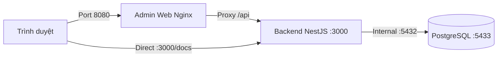

# Kế hoạch & Quy trình tuần tự các bước chạy dự án TrackerX

Tài liệu này hướng dẫn **thứ tự chuẩn từng bước (Step-by-Step Sequence)** để khởi động dự án TrackerX từ con số 0 đến khi các dịch vụ hoạt động hoàn chỉnh, cùng cách kiểm tra và dừng hệ thống.

---

## 1. Mục tiêu & Các lựa chọn môi trường

Dự án gồm 3 phần chính:
1. **Cơ sở dữ liệu**: PostgreSQL 16 (chạy qua Docker).
2. **Backend API**: NestJS 11 (`http://localhost:3000/api`, tài liệu Swagger: `/docs`).
3. **Frontend Admin**: React 19 + Vite (`http://localhost:5173` hoặc Docker: `:8080`).
4. *(Tùy chọn)* **Mobile App**: Flutter (`mobile/app/`).

Tùy vào nhu cầu, bạn có thể chọn 1 trong 2 luồng chạy chính:
* **Luồng A (Khuyên dùng khi lập trình/phát triển)**: Chạy Database qua Docker, chạy Backend + Admin trực tiếp bằng Node/Vite (hỗ trợ hot-reload khi sửa code).
* **Luồng B (Chạy trọn gói qua Docker)**: Cả DB, API và Admin đóng gói container (phù hợp test staging/production).

---

## 2. QUY TRÌNH CHUẨN A: Chạy để phát triển (Development Mode)

Đây là quy trình khuyên dùng hàng ngày.

### Bước 1: Mở Docker Desktop
* Mở ứng dụng **Docker Desktop** trên Windows và đảm bảo biểu tượng Docker ở thanh Taskbar hiển thị trạng thái màu xanh (*Engine running*).

### Bước 2: Thiết lập hệ thống ban đầu (Chỉ chạy 1 LẦN ĐẦU TIÊN)
> [!NOTE]
> Nếu bạn đã từng chạy lệnh này rồi và database đã có dữ liệu, hãy bỏ qua Bước 2 và sang Bước 3.

Mở terminal PowerShell tại thư mục gốc của dự án (`Tracker---App-`):
```powershell
npm.cmd run setup
```
*Lệnh này sẽ tự động: cài npm packages, sinh các file `.env`, bật PostgreSQL `:5433`, chạy Prisma migration, và nạp sẵn tài khoản + dữ liệu demo.*

---

### Bước 3: Khởi động hệ thống (Hằng ngày)
Tại thư mục gốc của dự án, chạy lệnh:
```powershell
npm.cmd run dev
```
*Hệ thống sẽ đồng thời:*
1. Tự động kiểm tra và bật container PostgreSQL (`localhost:5433`).
2. Khởi động Backend API tại `http://localhost:3000`.
3. Khởi động Admin Web tại `http://localhost:5173`.

---

### Bước 4: Mở trình duyệt và kiểm tra

1. **Kiểm tra API & Swagger**:
   - Truy cập: 👉 **[http://localhost:3000/docs](http://localhost:3000/docs)**
   - Thử gọi `GET /api/health` ➔ Trả về `{"status": "ok", "db": "up"}` là API đã sẵn sàng.
2. **Kiểm tra Trang quản trị (Admin Web)**:
   - Truy cập: 👉 **[http://localhost:5173](http://localhost:5173)**
   - Đăng nhập bằng tài khoản Quản trị:
     - **Email**: `admin@thuchi.vn`
     - **Mật khẩu**: `admin123`

---

### Bước 5: Cách dừng hệ thống (Khi kết thúc làm việc)
1. Tại cửa sổ Terminal đang chạy `npm.cmd run dev`, bấm tổ hợp phím **`Ctrl + C`**, sau đó gõ **`Y`** rồi Enter để tắt Backend và Admin.
2. Nếu muốn tắt cả container PostgreSQL của Docker:
   ```powershell
   docker compose stop db
   ```

---

## 3. QUY TRÌNH B: Chạy trọn gói qua Docker (Docker Profile App)

Dùng khi bạn không muốn chạy Node.js trên máy mà muốn chạy toàn bộ trong các container khép kín.



### Bước 1: Đảm bảo giải phóng cổng 3000
Tắt tiến trình backend cục bộ nếu có đang chạy:
```powershell
Stop-Process -Id (Get-NetTCPConnection -LocalPort 3000 -ErrorAction SilentlyContinue).OwningProcess -Force
```

### Bước 2: Bật toàn bộ container
Tại thư mục gốc dự án:
```powershell
npm.cmd run docker:app
```
*(Hoặc: `docker compose --profile app up -d --build`)*

### Bước 3: Truy cập sử dụng
* **Admin Web (Nginx)**: 👉 **[http://localhost:8080](http://localhost:8080)** (Đăng nhập: `admin@thuchi.vn` / `admin123`)
* **Swagger API UI**: 👉 **[http://localhost:3000/docs](http://localhost:3000/docs)**

### Bước 4: Dừng container
```powershell
npm.cmd run docker:down
```

---

## 4. QUY TRÌNH C: Chạy App Mobile Flutter (Nếu phát triển Mobile)

Sau khi Backend API đã chạy ở Bước 3 (cổng 3000):

### Bước 1: Di chuyển vào thư mục mobile
```powershell
cd mobile/app
```

### Bước 2: Tải thư viện Flutter
```powershell
flutter pub get
```

### Bước 3: Chạy ứng dụng trên thiết bị
Tùy vào thiết bị bạn kết nối:
* **Chạy trên Windows Desktop**:
  ```powershell
  flutter run -d windows --dart-define=API_URL=http://localhost:3000/api
  ```
* **Chạy trên trình duyệt Chrome**:
  ```powershell
  flutter run -d chrome --dart-define=API_URL=http://localhost:3000/api
  ```
* **Chạy trên Android Emulator**:
  ```powershell
  flutter run -d android --dart-define=API_URL=http://10.0.2.2:3000/api
  ```
* **Chạy trên Điện thoại thật (cắm USB / cùng mạng Wi-Fi)**:
  ```powershell
  flutter run --dart-define=API_URL=http://<IP-LAN-máy-tính>:3000/api
  ```

> Đăng nhập tài khoản mẫu trên app mobile: **`demo@thuchi.vn`** / **`demo123`** (khớp đầy đủ 4 ví, lịch sử 12 tháng, mục tiêu tiết kiệm).

---

## 5. Bảng tổng hợp thứ tự thao tác nhanh (Cheat Sheet)

```
[BƯỚC 1] Bật Docker Desktop
    │
[BƯỚC 2] Lần đầu: npm.cmd run setup
    │
[BƯỚC 3] Chạy hệ thống: npm.cmd run dev
    │
[BƯỚC 4] Mở kiểm tra:
    ├── Swagger: http://localhost:3000/docs
    └── Admin:   http://localhost:5173  (admin@thuchi.vn / admin123)
    │
[BƯỚC 5] Dừng hệ thống: Bấm Ctrl + C tại Terminal
```

---

## 6. Xử lý sự cố thường gặp (Troubleshooting)

| Tình trạng | Nguyên nhân | Cách khắc phục |
|---|---|---|
| **Port 3000 is in use** | Có tiến trình Node đang chạy ngầm | Chạy: `Stop-Process -Id (Get-NetTCPConnection -LocalPort 3000).OwningProcess -Force` |
| **Vite nhảy sang cổng 5174, 5175** | Terminal cũ chưa tắt hẳn | Chạy: `Stop-Process -Id (Get-NetTCPConnection -LocalPort 5173, 5174).OwningProcess -Force` rồi chạy lại `npm.cmd run dev` |
| **Không kết nối được máy chủ** | Trình duyệt chặn CORS | Đã được cấu hình sẵn trong `.env` (`CORS_ORIGINS`). Hoặc dùng `http://localhost:8080` khi chạy Docker |
| **Bị lỗi đỏ PowerShell ExecutionPolicy** | Chính sách bảo mật Windows | Dùng lệnh có đuôi `.cmd` (ví dụ `npm.cmd run dev`) hoặc chạy `Set-ExecutionPolicy -ExecutionPolicy RemoteSigned -Scope CurrentUser` |
