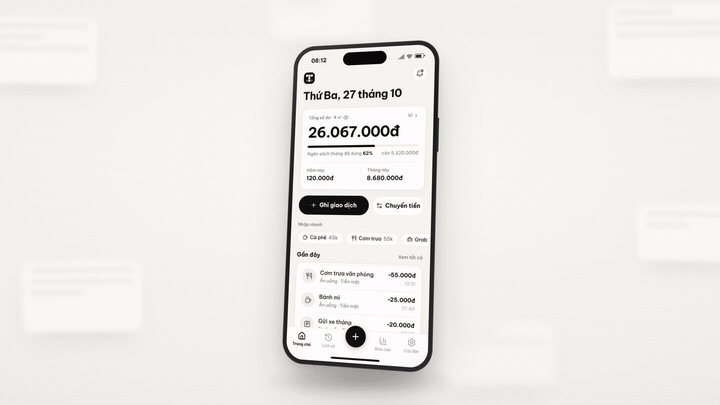
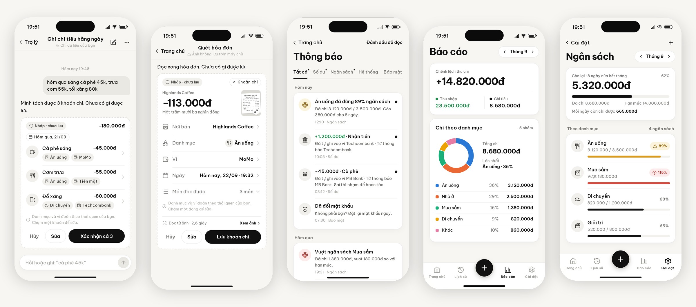
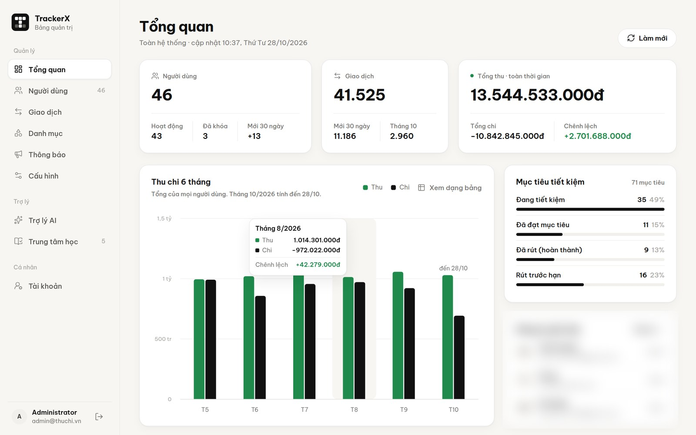
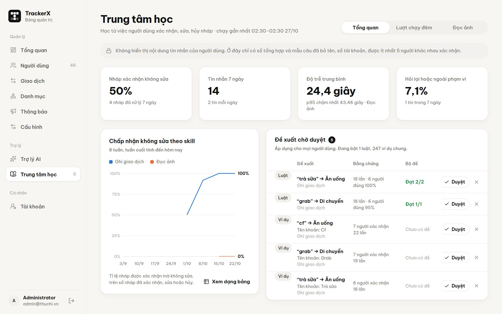
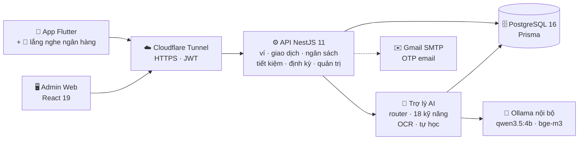

<div align="center">


# TrackerX

**Quản lý thu chi cá nhân, tích hợp trợ lý AI chạy nội bộ.**<br>
Nói một câu, chụp một tấm, hoặc không làm gì cả — giao dịch tự vào sổ.

*Personal finance tracker with an on-premise AI assistant, receipt OCR and bank-notification auto-recording.*

[](mobile/)
[](backend/)
[](admin/)
[](docker-compose.yml)
[](ai/)
[](#-kiểm-thử)
[](LICENSE)

[**Xem video**](https://github.com/xT-chinhan/Tracker---App-/releases/download/v1.0.0/TrackerX-intro-60s.mp4) ·
[**Tải APK**](https://github.com/xT-chinhan/Tracker---App-/releases/latest) ·
[**Trang quản trị**](https://tracker-xt.freepro.online) ·
[**Tài liệu API**](https://tracker-xt.freepro.online/api/docs) ·
[**Báo cáo PDF**](docs/bao-cao/Bao-cao-Lap-trinh-di-dong.pdf)

</div>

---

## 🎬 Giới thiệu

<div align="center">

<a href="https://github.com/xT-chinhan/Tracker---App-/releases/download/v1.0.0/TrackerX-intro-60s.mp4">
  
</a>

<sub>Trích đoạn video giới thiệu · <a href="https://github.com/xT-chinhan/Tracker---App-/releases/download/v1.0.0/TrackerX-intro-60s.mp4">xem bản đầy đủ 60 giây (MP4)</a></sub>

</div>

Ghi chép chi tiêu luôn bị bỏ dở: nhập tay mệt, tiền nằm rải rác ở ngân hàng, ví điện tử, tiền mặt, còn nhờ AI trên mạng thì lộ dữ liệu tài chính. **TrackerX** giải bài toán đó bằng ba cách ghi giao dịch gần như không tốn công, và một trợ lý AI chạy hoàn toàn trên máy chủ của nhóm.

<div align="center">
  
</div>

## ✨ Tính năng nổi bật

| | Tính năng | Mô tả |
|---|---|---|
| 💬 | **Nói một câu** | Gõ *"cf 45k hôm qua, trưa cơm 55k"* → AI tách từng khoản, đoán danh mục và ví theo thói quen của bạn, tạo **nháp** — chỉ lưu khi bạn xác nhận. |
| 📷 | **Chụp một tấm** | Đọc hóa đơn và ảnh chuyển khoản (OCR bằng model vision nội bộ): số tiền, nơi bán / người nhận, tự biết **thu hay chi**. Ảnh đọc xong là xóa, không lưu trên máy chủ. |
| 🔔 | **Không làm gì cả** | App Android lắng nghe thông báo ngân hàng / ví điện tử và **tự ghi vào sổ**, chống ghi trùng giữa thông báo app và SMS, có nút hoàn tác. |
| 🧠 | **AI tự học thói quen** | Xác nhận / sửa nháp, "Ý tôi là…", 👍/👎 đều là tín hiệu học. Luật riêng bật sau 3 lần đúng (≥85%); ban đêm gom thành luật chung **ẩn danh** (≥5 người), qua cổng kiểm định hồi quy rồi mới áp dụng. |
| 🔒 | **Riêng tư theo thiết kế** | Mỗi người dùng là một phiên AI riêng — mọi truy vấn dữ liệu AI gắn với người đang đăng nhập, prompt chỉ chứa dữ liệu của chính người hỏi. Không gọi API AI bên ngoài. |
| 💰 | **Quản lý tài chính đầy đủ** | Nhiều ví, chuyển tiền, ngân sách tháng (cảnh báo 80% / 100%), mục tiêu tiết kiệm, giao dịch định kỳ, mẫu nhập nhanh, báo cáo, thông báo theo loại. |
| 🛠️ | **Trang quản trị** | Tổng quan hệ thống, quản lý người dùng, cấu hình runtime (AI, OCR, SMTP, giới hạn…), **Trung tâm học AI** duyệt luật chung, trợ lý AI cho admin. |

<table>
  <tr>
    <td width="50%"></td>
    <td width="50%"></td>
  </tr>
  <tr>
    <td align="center"><sub>Admin · Tổng quan hệ thống</sub></td>
    <td align="center"><sub>Admin · Trung tâm học AI (luật chung chờ duyệt)</sub></td>
  </tr>
</table>

## 🏗️ Kiến trúc



**Luồng "nói một câu":** câu của người dùng → *router* (luật đã học + kNN embedding bge-m3) chọn kỹ năng → *parser tiếng Việt* bằng code bóc số tiền, ngày, ví → LLM chỉ chọn danh mục và đặt tên theo **JSON schema** → code kiểm tra lại → **nháp** chờ người dùng xác nhận. Số tiền và ngày luôn do code quyết định, không để model "bịa".

## 🧰 Công nghệ

| Tầng | Công nghệ |
|---|---|
| **Mobile** | Flutter 3.44 · Dart 3.12 · Riverpod · go_router · Dio · Freezed · Kotlin (NotificationListener) |
| **Backend** | NestJS 11 · TypeScript · Prisma 6 · PostgreSQL 16 · JWT · Swagger / OpenAPI |
| **Admin** | React 19 · Vite · Tailwind 4 · shadcn/ui · TanStack Query · Recharts |
| **AI** | Ollama · qwen3.5:4b (chat + vision) · bge-m3 (embedding) · kNN · JSON schema |
| **Vận hành** | Docker Compose · Cloudflare Tunnel · systemd · Playwright · e2e API |

## 🚀 Bắt đầu nhanh

**Yêu cầu:** Node.js 22+, Docker (compose v2). Tùy chọn: [Ollama](https://ollama.com) cho trợ lý AI, Flutter 3.44 cho app mobile.

```bash
git clone https://github.com/xT-chinhan/Tracker---App-.git trackerx && cd trackerx
npm run setup     # cài dependency, tạo .env, bật PostgreSQL (Docker :5433), migrate, seed, nạp dữ liệu demo
npm run dev       # API  → http://localhost:3000/api   (Swagger: /api/docs)
                  # Admin → http://localhost:5173
```

<details>
<summary><b>Bật trợ lý AI (Ollama)</b></summary>

```bash
ollama pull qwen3.5:4b && ollama pull bge-m3
npm run db:seed:demo && npm run db:seed:demo:ai   # dữ liệu demo + lịch sử AI đã học thói quen
```

Hướng dẫn đầy đủ (GPU, cấu hình, kiểm tra): [docs/CAI-DAT-AI.md](docs/CAI-DAT-AI.md).
</details>

<details>
<summary><b>Chạy app mobile</b></summary>

```bash
cd mobile/app && flutter pub get && flutter run
```

App trỏ cố định tới máy chủ demo (xem [API-URL.md](API-URL.md)). Build APK phát hành, bản thường và bản có lắng nghe ngân hàng: [mobile/PHAT-HANH-APK.md](mobile/PHAT-HANH-APK.md).
</details>

<details>
<summary><b>Triển khai bằng Docker</b></summary>

```bash
cp .env.example .env                       # đặt JWT_SECRET ≥ 16 ký tự
docker compose --profile app up -d --build
#   Admin: http://localhost:8080 (nginx, /api proxy sang container api)
#   API:   http://localhost:3000/api
```

Biến môi trường và các profile: [backend/README.md](backend/README.md).
</details>

| Lệnh | Việc |
|---|---|
| `npm run setup` | Cài đặt lần đầu (chạy lại được, không ghi đè `.env`) |
| `npm run dev` | Backend (watch) + Admin (Vite) |
| `npm run test` | Toàn bộ kiểm thử trên DB test riêng |
| `npm run build` | Build backend + admin |
| `npm run db:seed:demo` · `db:seed:demo:ai` | Nạp lại dữ liệu demo · lịch sử AI demo |

## 🔑 Tài khoản demo

| Vai trò | Email | Mật khẩu |
|---|---|---|
| Quản trị | `admin@thuchi.vn` | `admin123` |
| Người dùng (AI đã học thói quen) | `demo@thuchi.vn` | `demo123` |
| Người dùng khác | `<tên>@demo.thuchi.vn` — vd `hung.vu89@demo.thuchi.vn` | `demo123` |

Dữ liệu demo: ~40 người dùng, 12 tháng, ~41.000 giao dịch, ngân sách, mục tiêu, định kỳ, cùng lịch sử trợ lý AI (luật riêng *"cf" → Ăn uống*, trí nhớ ví hay dùng, luật chung chờ duyệt).

## ✅ Kiểm thử

| Bộ kiểm thử | Số ca | Công cụ |
|---|---:|---|
| API end-to-end (gồm trợ lý AI với model giả lập tất định) | **1.024** | `backend/scripts/e2e.mjs` |
| Ứng dụng Flutter (unit + widget) | **107** | `flutter test` |
| Trang quản trị | **54** | Playwright |
| Bất biến dữ liệu demo | ~560 | `npm run demo:verify` |

`npm run test` tự tạo DB `tracker_test`, nạp dữ liệu demo, bật API ở chế độ test rồi chạy lần lượt các bộ trên và dọn dẹp sau khi xong.

## 📁 Cấu trúc thư mục

```
.
├── backend/        # NestJS API: src/<module>, prisma (schema, migrations, seed), scripts (e2e)
├── admin/          # Trang quản trị React + e2e Playwright
├── mobile/
│   ├── app/        # App Flutter (lib/features/*, test/)
│   └── modules/    # Module native: bank_notification_listener (Kotlin)
├── ai/             # Thư viện AI: parser tiếng Việt, router, skills, đánh giá, nghiên cứu
├── design/         # Mockup đã duyệt (mobile, admin), token thiết kế, thương hiệu
├── docs/           # Hướng dẫn: cài AI, test, demo, Swagger, quyết định AI, thuyết trình
├── scripts/        # setup / test cho cả repo
└── docker-compose.yml
```

## 📚 Tài liệu

| Tài liệu | Nội dung |
|---|---|
| [**Báo cáo đồ án (PDF, 59 trang)**](docs/bao-cao/Bao-cao-Lap-trinh-di-dong.pdf) | Báo cáo môn Lập trình di động: phân tích, thiết kế, cài đặt, kiểm thử |
| [Slide thuyết trình (HTML)](docs/thuyet-trinh/index.html) | Bài thuyết trình 16 trang — tải về mở bằng trình duyệt |
| [backend/README.md](backend/README.md) | Nghiệp vụ, endpoint, biến môi trường, dữ liệu demo |
| [docs/CAI-DAT-AI.md](docs/CAI-DAT-AI.md) | Cài Ollama và model cho trợ lý AI |
| [docs/AI-DECISIONS.md](docs/AI-DECISIONS.md) | Các quyết định thiết kế của trợ lý AI |
| [docs/HUONG_DAN_TEST_API.md](docs/HUONG_DAN_TEST_API.md) | Gọi thử API qua Swagger |
| [docs/HUONG-DAN-TEST.md](docs/HUONG-DAN-TEST.md) | Kịch bản kiểm thử cho nhóm |
| [docs/HUONG_DAN_DEMO.md](docs/HUONG_DAN_DEMO.md) | Quy trình chạy demo từng bước |
| [mobile/BANK-NOTIFICATIONS.md](mobile/BANK-NOTIFICATIONS.md) | Lắng nghe thông báo ngân hàng |
| [mobile/PHAT-HANH-APK.md](mobile/PHAT-HANH-APK.md) | Build và phát hành APK |
| [design/DESIGN.md](design/DESIGN.md) | Hệ thống thiết kế |

## 👥 Nhóm thực hiện

Đồ án môn **Lập trình di động** — Trường Đại học Công nghệ TP.HCM (**HUTECH**) · Nhóm **NgọngNL** · Lớp 23DTHC3<br>
Giảng viên hướng dẫn: **Thầy Nguyễn Mạnh Hùng**

| Thành viên |
|---|
| Bùi Nguyễn Công Nghiệp |
| Nguyễn Chí Nhân |
| Lưu Văn Lương |
| Võ Thành Nhân |

Đóng góp và báo lỗi: xem [CONTRIBUTING.md](CONTRIBUTING.md).

## 📄 Giấy phép

Phát hành theo giấy phép [MIT](LICENSE).

<div align="center">
<sub><b>TrackerX</b> · Tiền rõ ràng, sống nhẹ nhàng.</sub>
</div>
